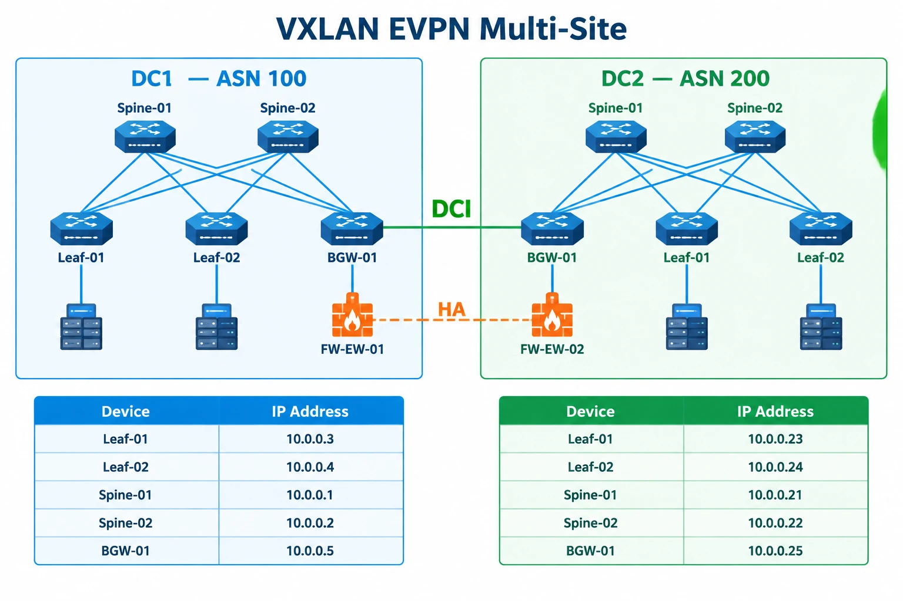

# VXLAN EVPN Multi-Site with Palo Alto HA

This repository documents my two-site EVE-NG lab combining a Nexus VXLAN EVPN Multi-Site fabric with a Palo Alto active/passive firewall pair.

The main goal is to make routing follow the active firewall: use the local firewall when it is active, and reach the remote firewall through EVPN when the local firewall is passive.

## Topology

Each site has two spines, two leaves, and one border gateway. The border gateways connect over the DCI.

| Site | BGP ASN | Firewall |
|---|---|---|
| DC1 | 100 | FW-EW-01 |
| DC2 | 200 | FW-EW-02 |

In the baseline setup, FW-EW-01 is active and FW-EW-02 is passive.

### Device IPs

| Device | DC1 | DC2 |
|---|---|---|
| Spine-01 | 10.0.0.1 | 10.0.0.21 |
| Spine-02 | 10.0.0.2 | 10.0.0.22 |
| Leaf-01 | 10.0.0.3 | 10.0.0.23 |
| Leaf-02 | 10.0.0.4 | 10.0.0.24 |
| BGW-01 | 10.0.0.5 | 10.0.0.25 |

### Workload and firewall transit networks

| Network | VLAN | Subnet |
|---|---|---|
| DB | 998 | 10.104.169.0/24 |
| APP | 999 | 10.104.168.0/24 |

| Firewall transit | VLAN | Firewall next hop |
|---|---|---|
| APP | 902 | 10.111.0.147 |
| DB | 903 | 10.111.0.155 |

## Why IP SLA?

During the lab, the Nexus interface state in EVE-NG did not reliably reflect the passive firewall state. Relying on the physical link alone was therefore not enough to control the static routes.

I used IP SLA and tracking to monitor the firewall transit addresses and control the associated local static routes.

The intended routing behavior is:

- At the active site, use the local tracked static routes.
- At the passive site, use the routes learned through EVPN.
- If a tracked probe fails, remove the dependent local static route.

This is a reachability check, not a full firewall health check. A successful ping to a transit IP does not prove that application traffic can pass through the firewall.

## What I have checked so far

With the DC1 firewall active and the DC2 firewall passive:

- BGP EVPN sessions were established.
- DC2 received EVPN routes from DC1.
- Tracks 10 and 20 were UP on DC1 and DOWN on DC2.
- The checked routes on DC1 used local static routes with administrative distance 1.
- The checked routes on DC2 used EVPN-learned BGP routes with administrative distance 20.

These checks confirm the baseline routing state. They do not yet confirm end-to-end failover.

## Still to test

- Trigger firewall HA failover while sending traffic between the workload networks.
- Check route withdrawal and installation on both BGWs.
- Measure packet loss and recovery time.
- Repeat the checks when moving the active role back to DC1.
- Complete the BUM replication and inter-site route-target review.

The leaf L2VNIs use multicast groups, while the BGWs use ingress replication. This remains a review item; I have not treated the current configuration as fully validated.

## Configuration files

The ten Nexus configuration files are stored in the repository root:

| DC1 | DC2 |
|---|---|
| [Leaf-01](01-dc1-leaf01.txt) | [Leaf-01](06-dc2-leaf01.txt) |
| [Leaf-02](02-dc1-leaf02.txt) | [Leaf-02](07-dc2-leaf02.txt) |
| [BGW-01](03-dc1-bgw01.txt) | [BGW-01](08-dc2-bgw01.txt) |
| [Spine-01](04-dc1-spine01.txt) | [Spine-01](09-dc2-spine01.txt) |
| [Spine-02](05-dc1-spine02.txt) | [Spine-02](10-dc2-spine02.txt) |

Palo Alto configurations and appliance images are not included.

## Before reusing these configs

This is a lab, not a production deployment template. Review interface mappings, addressing, routing policies, and software-specific behavior before adapting it.

